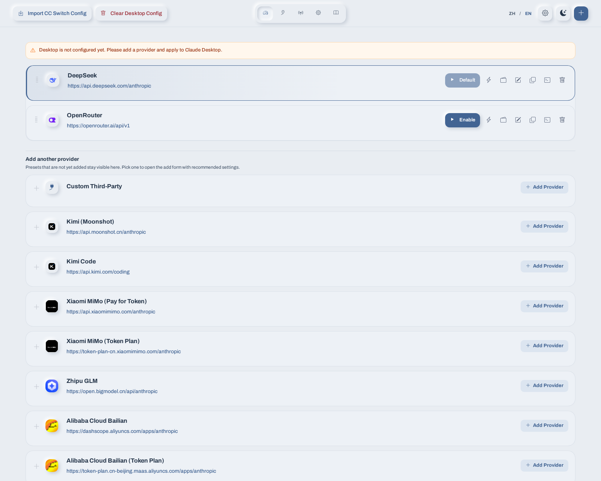
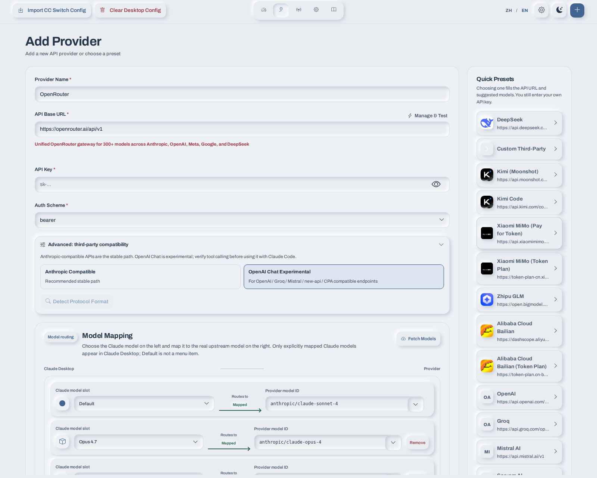
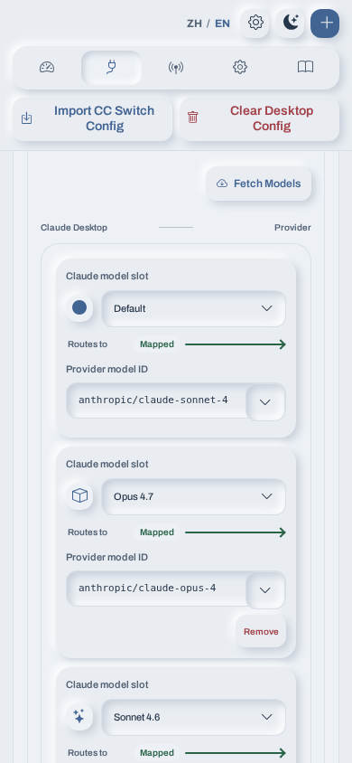

# Junction

**Manage Claude Desktop providers and model routes from one local app.**

Product website: [claude-junction.vercel.app](http://claude-junction.vercel.app)


Junction helps Windows and macOS users connect Claude Desktop to Anthropic-compatible and OpenAI-compatible API providers. Choose a provider, set the model routes you want, then apply the configuration to Claude Desktop.

The app includes 22 built-in provider presets, bundled provider logos, a model-routing patchboard, connection checks, and an optional local forwarding gateway. Logos are stored with the app and work offline; custom or unlisted providers keep a readable icon fallback. Your API keys and provider configuration are kept in your local app configuration. You supply and pay for your own provider access.

The interface is available in English and Simplified Chinese. New installations start in English regardless of the operating system language. Your language choice is saved and restored when the app next starts.

## Screenshots

These genuine app screenshots were captured locally with sample configuration and placeholder credentials. No real API keys are used; screenshots are committed directly.

| Provider dashboard | Desktop model routing |
| --- | --- |
|  |  |

### Mobile model routing



## What you can do

- Manage provider endpoints and switch the active provider.
- Start from a built-in preset or enter a compatible endpoint yourself.
- Map Claude Desktop model slots to the model IDs supported by your provider.
- Check provider connectivity and test model availability.
- Use the local forwarding gateway for model mapping, supported API-format adaptation, and optional upstream HTTP or SOCKS proxies.
- Import supported CC-Switch provider configurations.
- Keep the app running in the Windows system tray or macOS menu bar while Claude Desktop uses the local gateway.

Junction applies settings to the official Claude Desktop app. It is not a Claude Code provider manager and is not affiliated with Anthropic or any listed provider.

## Built-in providers

Presets provide a starting point for the endpoint, authentication scheme, API format, and model mapping. Preset values may change as providers update their APIs. Review the provider's current documentation and enter your own API key before using a preset.

| API type | Presets |
| --- | --- |
| Anthropic-compatible | DeepSeek, Custom third-party, Kimi, Kimi Code, Xiaomi MiMo Pay-as-you-go, Xiaomi MiMo Token Plan, Zhipu GLM, Alibaba Cloud Bailian, Alibaba Cloud Bailian Token Plan |
| OpenAI-compatible | OpenAI, Groq, Mistral, Sarvam, OpenRouter, Google Gemini, xAI, Together AI, Fireworks AI, Cerebras, Perplexity, Cohere |
| Local OpenAI-compatible | Ollama |

The Xiaomi MiMo Token Plan preset includes selectable regional clusters. You still need a valid account and API key for the selected service. Availability, model names, pricing, and terms are controlled by each provider.

## Download

[Open the latest release page](https://github.com/sarang-cmd/junction/releases/latest) to download an installer or portable package. The published v1.0.28 release uses Junction-prefixed asset filenames.

- **Windows x64 installer:** `Junction-v1.0.28-Windows-Setup.exe`
- **Windows x64 portable:** `Junction-v1.0.28-Windows-Portable.zip`
- **macOS Apple silicon installer:** `Junction-v1.0.28-macOS-arm64.pkg`
- **macOS Apple silicon disk image:** `Junction-v1.0.28-macOS-arm64.dmg`
- **macOS Intel installer:** `Junction-v1.0.28-macOS-x64.pkg`
- **macOS Intel disk image:** `Junction-v1.0.28-macOS-x64.dmg`

Each release includes SHA-256 files, detached signatures, the release public key, and an update manifest. Windows executables are not Authenticode-signed, so Windows may show an unknown publisher warning. Verify downloaded files against the included checksums and signatures if needed.

## Get started

1. Install and open Junction.
2. Choose a preset or add a provider manually.
3. Enter the API key issued by that provider.
4. Review the model-routing patchboard and map the Claude Desktop slots you plan to use.
5. Select **Apply to Claude Desktop**.
6. Fully quit and restart Claude Desktop so it reloads the provider settings.

Claude Desktop uses the local Junction gateway for configured third-party providers. Keep Junction running while you use those providers. Closing the main window leaves the app available from the system tray on Windows or the menu bar on macOS.

The local admin UI uses port `18081` by default. The forwarding gateway uses port `18080`. Both can be changed in Settings. If the desktop window does not open, try `http://127.0.0.1:18081` while the app is running.

## Model routing

Claude Desktop sends Claude-family model names, while providers may expose different model IDs. The patchboard makes each route explicit: a Claude Desktop model slot on one side and the provider's model ID on the other. Only routes with a mapped upstream model are offered to Claude Desktop. `Default` is an internal fallback, not a model-menu entry.

The app validates custom Claude route names and reports unmapped routes rather than silently forwarding them to an unrelated model. Provider-specific capabilities and preset options remain available alongside the patchboard.

## Privacy and local data

Junction has no account or cloud configuration sync. Provider settings and API keys are stored in the app's local configuration directory. The default is `~/.cc-desktop-switch`; set `CCDS_CONFIG_DIR` to use another directory. Local backups may also be created when configuration changes.

When you make a provider request, the app forwards it to the endpoint you configured. That provider's service and privacy terms govern the request after it leaves your computer. The app can also check GitHub Releases for update metadata using the configured update URL. Do not put real API keys in screenshots, issue reports, or shared diagnostic files.

Legal documents are not finalized. The repository contains a [privacy policy draft](docs/PRIVACY_POLICY_DRAFT.md) and [terms of use draft](docs/TERMS_DRAFT.md) for maintainer and legal review. Do not treat these drafts as binding terms.

## Troubleshooting

### Claude Desktop still uses the previous provider

Claude Desktop reads provider settings at startup. Fully quit Claude Desktop, including any background process, and open it again after applying a provider.

### Claude Desktop cannot connect

Confirm Junction is running. Check that the admin UI and gateway ports are available:

```powershell
netstat -ano | findstr :18081
netstat -ano | findstr :18080
```

Check the provider's base URL, API key, model ID, and API format. If you use an upstream proxy, confirm that it is enabled and reachable from this computer.

### Claude Desktop reports that it is managed by an organization

Current Windows releases store Junction's connection in Claude Desktop's `configLibrary` and change only `deploymentMode` in Claude's desktop config. They do not create registry policy values. Apply and Clear remove only known legacy HKCU values carrying Junction's `ccds_managed=true` marker; unknown or unmarked values are preserved and reported. Junction never clears HKLM. If Claude still reports that it is managed, review the exact remaining policy path with your administrator. Older releases may need **Clear Desktop Config** once to migrate their marked values.

### Model or reasoning errors

Check the provider's current model ID and API compatibility. Keep the exact diagnostic message when reporting an issue, but redact API keys, authorization headers, and private endpoint details first.

## Build from source

Requirements: Python 3.11 or later and Node.js for JavaScript syntax checks. Windows packaging also uses PyInstaller and NSIS. macOS packages are built by the scripts under `macos/` on the matching macOS architecture.

```bash
git clone https://github.com/sarang-cmd/junction.git
cd junction
python -m pip install -r requirements.txt
python main.py
```

To open the app in a browser during development:

```bash
python main.py --browser
```

Run the checks before submitting a change:

```bash
python -m compileall -q backend main.py tests
python -m unittest discover -s tests -v
node --check frontend/js/api.js
node --check frontend/js/app.js
node --check frontend/js/i18n.js
python scripts/check_i18n.py
```

The localization check verifies English and Simplified Chinese dictionary parity and scans application source for untranslated CJK text.

## Technology

- Python, FastAPI, Uvicorn, and HTTPX
- HTML, CSS, and vanilla JavaScript
- Locally bundled Bootstrap styles and Bootstrap Icons
- PyInstaller, NSIS, and macOS package scripts

## License and third-party services

See [LICENSE.txt](LICENSE.txt) for the project license. Junction is not affiliated with Anthropic, Claude Desktop, CC-Switch, or any provider named in this README. Provider names and marks belong to their respective owners. Users are responsible for their own API usage and compliance with provider terms.
